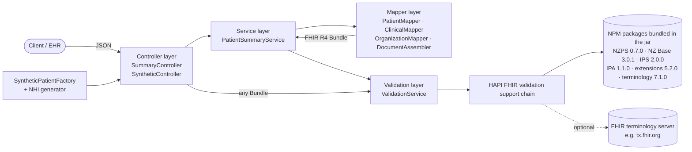

# NZ Patient Summary Service

[](https://github.com/YOUR-GITHUB-USER/nz-patient-summary/actions/workflows/ci.yml)

A Spring Boot service that **generates and validates New Zealand Patient Summaries** as HL7® FHIR® R4
document Bundles, conforming to the official **NZ Patient Summary (NZPS)** profiles published by
Health NZ | Te Whatu Ora. NZPS builds on the **International Patient Summary (IPS)** and the
**HL7 NZ Base** implementation guide.

> All data in this repository is **synthetic**. NHI numbers are generated, every resource is tagged
> `HTEST` (*test health data*), and no real patient information is ever used.

---

## What it does

| Endpoint | Purpose |
|---|---|
| `POST /summary/generate` | Takes simple, clinician-friendly JSON (demographics, problems, medications, allergies, immunizations) and returns an NZPS **document Bundle**. The Composition is the first entry, and the response headers report the validation result. |
| `POST /summary/validate` | Validates **any** FHIR resource against NZPS + NZ Base + IPS and returns a FHIR `OperationOutcome`. |
| `GET /synthetic/patient?seed=` | Returns a realistic but fake NZ patient as JSON input, ready for `/summary/generate`. The same seed always gives the same patient. |
| `GET /synthetic/summary?seed=` | Returns a complete, validated NZPS Bundle for a synthetic patient. |
| `GET /` | **Bundle viewer**: a web page to load synthetic patients, open or paste Bundles, and read them as a clinical summary with validation issues. |
| `GET /actuator/health` | Liveness and readiness. |

## Why it matters

- **FHIR in New Zealand.** Health NZ lists HL7 FHIR among its principal interoperability standards,
  and NZ Base is the national foundation for FHIR implementations.
- **The patient summary is a national standard.** *HISO 10099:2022 NZ International Patient
  Summary* is the NZ adaptation of the international IPS standard (ISO 27269 / HL7 IPS). The NZPS
  FHIR IG is its FHIR representation.
- **The NHI is changing.** From **1 July 2027** Health NZ will issue NHIs in a new format, `AAANNAX`,
  with a modulus-23 check letter. Every system must accept both formats indefinitely, and this
  service implements and tests both.
- **Validation is the hard part.** Producing JSON is easy. Producing documents that pass the real
  national profiles, with their slicing, invariants and terminology bindings, is where FHIR projects
  succeed or stall. This project shows that work end to end, including the defects found in the
  published packages.

---

## Architecture



```
src/main/java/nz/portfolio/patientsummary
├── controller/   REST endpoints; errors returned as FHIR OperationOutcome
├── service/      orchestration: map → assemble → serialise → validate
├── mapper/       JSON DTO → NZPS resources; Composition + document Bundle assembly
├── validation/   validator wiring, NPM package loading, documented profile patches
├── synthetic/    NHI algorithm, synthetic NZ patient factory
├── dto/          request records with Bean Validation
└── fhir/         canonical URLs / code systems / profiles, narrative helper
```

**Tech stack:** Java 21 · Spring Boot 3.5 · HAPI FHIR 8.12 (structures R4 + validator) · Maven
Wrapper · JUnit 5 / AssertJ / MockMvc · Docker (multi-stage, non-root) · GitHub Actions.

---

## Standards and FHIR packages

| Package | Version | Source |
|---|---|---|
| `tewhatuora.fhir.nzps` (NZ Patient Summary) | **0.7.0** | [fhir-ig.digital.health.nz/nzps](https://fhir-ig.digital.health.nz/nzps/). Not published to any registry, so it is vendored in `src/main/resources/fhir-packages` (CC0 licence). |
| `fhir.org.nz.ig.base` (HL7 NZ Base) | **3.0.1** | packages.fhir.org |
| `hl7.fhir.uv.ips` (International Patient Summary) | **2.0.0** | packages.fhir.org |
| `hl7.fhir.uv.ipa`, `hl7.fhir.uv.extensions.r4`, `hl7.terminology.r4` | 1.1.0 / 5.2.0 / 7.1.0 | packages.fhir.org |

**Why not the latest NZ Base (3.1.0) and IPS (2.0.1)?** NZPS 0.7.0 was published against NZ Base
3.0.1 and IPS 2.0.0. Mixing versions would load two copies of the same canonical profiles, and the
validator's results would then depend on which copy it picked. The pin follows NZPS's own
`package.json`.

The registry packages are downloaded **once at build time**, checked against pinned SHA-256 hashes,
and bundled inside the jar. The Docker image therefore validates **fully offline** and never
downloads packages at start-up.

---

## FHIR profile constraints handled

| Constraint | Source | How it is handled |
|---|---|---|
| `Bundle.type = document`; `identifier` and `timestamp` 1..1; every entry has a `fullUrl` | Bundle-uv-ips | `DocumentAssembler` sets a `urn:uuid` identifier, an NZ-time timestamp and `urn:uuid` fullUrls. |
| **bdl-ips-1**: only the first entry may be a Composition | Bundle-uv-ips | The Composition is always entry 0. |
| Composition `type` = LOINC **60591-5**; Problems (11450-4), Allergies (48765-2) and Medications (10160-0) sections are mandatory | Composition-uv-ips | All three sections are always present. Immunizations (11369-6) is added when there is data. |
| **ips-comp-1**: each mandatory section has entries *or* an `emptyReason` | Composition-uv-ips | Empty sections get `emptyReason = nilknown` plus a narrative. Base rule **cmp-2** forbids an `emptyReason` on a section with entries. |
| `name` 1..* and `birthDate` 1..1 | Patient-uv-ips | Enforced in the input DTO with Bean Validation. |
| NHI identifier: system `https://standards.digital.health.nz/ns/nhi-id`, `use = official`; **nz-pat-1** allows at most one official NHI | nzps-patient / NzPatient | One official NHI, which must pass the check-digit algorithm before mapping. |
| Ethnicity via the `nz-ethnicity` extension (0..6), Stats NZ **level 4** codes | NZ Base / nzps-patient | Codes and displays are resolved from the NZ Base CodeSystem, so unknown codes are rejected with HTTP 400. |
| Address as `NzAddress`, with the suburb in the `suburb` extension | NZ Base | `PatientMapper.toAddress`. |
| `MedicationStatement.effective[x]` 1..1 | MedicationStatement-uv-ips | Uses `effectivePeriod.start` when known. Otherwise sends an empty `dateTime` carrying the `data-absent-reason = unknown` extension. |
| Optional NZMT coding slice (`http://nzmt.org.nz`) on medications | nzps-medicationstatement | Added when `nzmtCode` is supplied. |
| **con-3**: problem-list Conditions need a `clinicalStatus` | FHIR R4 core | Defaults to `active`. Verification status is `confirmed`, category is `problem-list-item`. |
| Problems, allergies, medications and vaccines in SNOMED CT | IPS value set bindings | All clinical concepts are SNOMED CT. |

### Defects found in the published packages (and how they are handled)

These are handled **in memory at start-up**, without changing the package files, and are documented
in code ([ProfilePatches](src/main/java/nz/portfolio/patientsummary/validation/ProfilePatches.java),
[VersionTolerantValidationSupport](src/main/java/nz/portfolio/patientsummary/validation/VersionTolerantValidationSupport.java)):

1. **NZPS 0.7.0: the NHI identifier slicing cannot be satisfied.** `nzps-patient` slices
   `Patient.identifier` into `NHI` (`use` fixed to `official`) and `dormant` (`use` fixed to `old`),
   but discriminates on **`system` only**. Both slices fix the same NHI system, so *every* NHI
   identifier matches both slices, and the validator reports *"Element matches more than one slice"*.
   The patch adds `use` to the discriminator, which is what the profile clearly intends. *(Worth
   raising with the NZPS authors.)*
2. **IPS 2.0.0: versioned references that its own dependencies don't satisfy.** IPS references
   extensions as `…|5.3.0-ballot-tc1` and core types as `…|4.0.1`, but declares a dependency on
   `hl7.fhir.uv.extensions.r4#5.2.0`. A small validation-support module retries such lookups without
   the version. Without it, every IPS-derived resource fails with *"Unable to resolve the profile
   reference"*.

### Terminology: offline by default, server optional

- **Offline (default).** Code systems shipped in the packages are fully validated: NZ ethnicity,
  HL7 terminology, NHI use codes, UCUM and others. SNOMED CT and LOINC are not distributed in FHIR
  packages, so codes from them and the IPS value-set memberships come back as **warnings**, not
  errors.
- **Full terminology validation.** Set `FHIR_VALIDATION_TERMINOLOGY_SERVER_URL=https://tx.fhir.org/r4`.
  The example Bundles were validated this way once. The only finding was a LOINC display name, now
  corrected, and the final result was **0 errors**.

---

## NHI numbers

[`Nhi`](src/main/java/nz/portfolio/patientsummary/synthetic/Nhi.java) implements Health NZ's *NHI
Validation Routine*:

| Format | Pattern | Check character |
|---|---|---|
| Legacy | `AAANNNC` (e.g. `ZAA0067`) | Σ(value × weight 7…2) mod 11, then 11 − remainder. Remainder 0 means invalid; a result of 10 becomes `0`. |
| Expanded (issued from 1 July 2027) | `AAANNAX` (e.g. `ACA31FM`) | Σ(value × weight 7…2) mod 23, then 23 − remainder, mapped back to a letter. |

Letters `I` and `O` are never used; A=1 … Z=24. The unit tests cover Health NZ's published example
NHIs, the "no digit can follow ZZZ004" edge case and 10,000 generated numbers.

**Synthetic NHIs** always start with `Z`, like Health NZ's own documentation examples, and are
reproducible from a seed. Because a valid check digit alone does not guarantee a number is
unassigned, every resource is also tagged `meta.tag = v3-ActReason#HTEST`.

---

## Develop (dev container, so no local JDK is needed)

The only requirements are **Docker** and **VS Code** with the *Dev Containers* extension.

1. Open the folder in VS Code and run **Dev Containers: Reopen in Container**.
   The container has Java 21, Maven, the Docker CLI (docker-outside-of-docker) and the Java and
   Spring Boot extensions. The Maven repository and FHIR package caches are kept in named volumes,
   so they survive rebuilds.
2. Inside the container:

```bash
./mvnw verify                 # unit tests + integration tests (full FHIR validation)
./mvnw spring-boot:run        # http://localhost:8080
./mvnw verify -Dexamples.regenerate=true   # regenerate /examples
```

## Run (Docker Compose)

```bash
docker compose up --build
```

This uses a multi-stage build: JDK 21 and Maven to build, then a slim **JRE 21 Alpine** image that
runs as a **non-root** user, with a readiness health check. The validator warms up at start-up
(about 8 s), so the first request is fast.

### Bundle viewer

Open **http://localhost:8080/** for a dependency-free web viewer served by the same container:

- **Load** a synthetic patient by seed (legacy or expanded NHI), open a `.json` file, or paste JSON.
  Both a FHIR Bundle and a `/summary/generate` request are accepted.
- **Summary tab:** a patient banner (NHI and its format, age, ethnicity, NZ address, *synthetic test
  data* flag), the document metadata, and each Composition section in order, with its entries shown
  as cards. Empty sections show their `emptyReason`.
- **Validation tab:** the `OperationOutcome` as a table you can filter by severity. Each card also
  shows a chip with the issues that point at its `Bundle.entry[n]`.
- **JSON tab:** the raw Bundle.

Narrative XHTML from uploaded Bundles is treated as untrusted. Only its text is displayed, and it is
never injected as HTML.

---

## Example requests

**Generate a summary**

```bash
curl -s -D - http://localhost:8080/summary/generate \
  -H "Content-Type: application/json" \
  -d '{
    "patient": {
      "nhi": "ZAA0067", "familyName": "Ngata", "givenNames": ["Aroha"],
      "gender": "female", "birthDate": "1984-03-14", "ethnicityCodes": ["21111"],
      "address": {"lines": ["12 Kowhai Street"], "suburb": "Ponsonby", "city": "Auckland", "postalCode": "1011"}
    },
    "author": {"organisationName": "Kowhai Synthetic Medical Centre", "city": "Auckland"},
    "conditions":   [{"snomedCode": "44054006", "display": "Diabetes mellitus type 2", "onsetDate": "2019-06-01"}],
    "medications":  [{"snomedCode": "372567009", "display": "Metformin", "dosageText": "500 mg orally twice daily", "startDate": "2019-06-01"}],
    "allergies":    [{"snomedCode": "764146007", "display": "Penicillin", "category": "medication", "criticality": "high",
                      "reactionSnomedCode": "39579001", "reactionDisplay": "Anaphylaxis"}],
    "immunizations":[{"snomedCode": "1181000221105", "display": "Influenza virus antigen only vaccine product", "occurrenceDate": "2025-04-14"}]
  }'
```

```
HTTP/1.1 200
X-Validation-Errors: 0
X-Validation-Warnings: 11
Content-Type: application/fhir+json
```

**Validate a Bundle**

```bash
curl -s http://localhost:8080/summary/validate \
  -H "Content-Type: application/fhir+json" \
  --data @examples/nzps-example-1.json
```

Optional `?profile=<canonical>` validates against a different profile. The default is `nzps-bundle`.

**Invalid input is rejected as a FHIR OperationOutcome**

```bash
# wrong NHI check digit
{"resourceType":"OperationOutcome","issue":[{"severity":"error","code":"invalid",
  "diagnostics":"patient.nhi: 'ZAA0068' fails the NHI check-digit validation","expression":["patient.nhi"]}]}
```

**Synthetic data**

```bash
curl -s "http://localhost:8080/synthetic/patient?seed=42&nhiFormat=EXPANDED"   # JSON input
curl -s "http://localhost:8080/synthetic/summary?seed=42"                      # validated Bundle
```

---

## Validation results

The three example Bundles in [`/examples`](examples) are committed together with their validation
reports (`*.validation.json`):

| Example | Highlights | Errors | Warnings (offline) |
|---|---|---|---|
| [nzps-example-1](examples/nzps-example-1.json) | Legacy NHI, two ethnicities (Indian + Samoan), *nil known* allergies, 3 immunizations | **0** | 14 |
| [nzps-example-2](examples/nzps-example-2.json) | Expanded-format NHI, Chinese ethnicity, food and drug allergies with reactions | **0** | 20 |
| [nzps-example-3](examples/nzps-example-3.json) | Legacy NHI, Tongan ethnicity, bee venom anaphylaxis, 3 problems | **0** | 17 |

All remaining offline warnings are terminology warnings (SNOMED CT, LOINC and NZMT value sets are
not available offline). With `tx.fhir.org` the examples also validate with **0 errors**.

### Tests

| Suite | What it covers |
|---|---|
| `NhiTest` | Health NZ example NHIs, invalid structures, check-digit edge cases, both generators |
| `PatientMapperTest`, `ClinicalMapperTest`, `DocumentAssemblerTest` | Mapping rules and IPS/NZPS structural constraints |
| `GeneratedSummaryValidationIT` | 20 synthetic patients (both NHI formats) validate with **zero errors** |
| `ExamplesIT` | The committed examples validate with **zero errors** |
| `ApiIT` | Endpoints, 400 OperationOutcomes, and a **negative control** proving the validator rejects non-conforming Bundles |

---

## Limitations and next steps

- NZPS 0.7.0 is a **draft** IG. The pinned versions should be bumped once NZPS publishes against
  NZ Base 3.1.0 and IPS 2.0.1.
- Clinical content covers the four core IPS sections. Results, vital signs, social history
  (smoking and vaping), procedures and care plans are natural next steps.
- SNOMED CT codes were chosen from the international edition and checked against tx.fhir.org. A
  production system would validate them against the **NZ Edition** via the NZ Health Terminology
  Service (NZHTS).
- No authentication is implemented (out of scope for a demo). A real deployment would add
  SMART on FHIR / OAuth2 and audit logging.

---

## About me

*Placeholder: a short introduction, your FHIR and NZ health sector experience, and contact links
(LinkedIn, email).*

---

*HL7® and FHIR® are registered trademarks of Health Level Seven International. SNOMED CT® is a
registered trademark of SNOMED International. This is an independent portfolio project, not
affiliated with or endorsed by Health NZ | Te Whatu Ora or HL7 New Zealand.*
